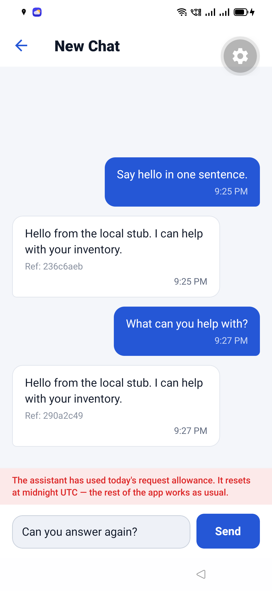
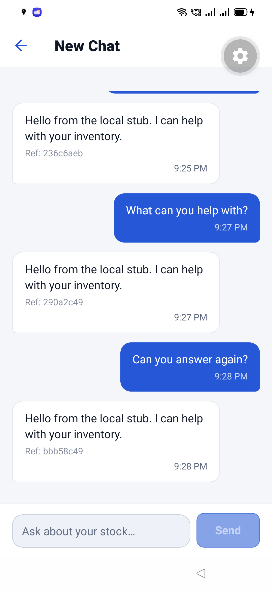

# Second quota refusal and recovery in one Android conversation (2026-11-13)

This record extends [`ai-quota-retry-2026-11-13`](../ai-quota-retry-2026-11-13/README.md), which
captured the first refusal. This run kept one conversation open and refused it twice. Each refusal
kept the unsent question in the composer; each retry after the 30-second block window succeeded
without retyping and retained every earlier turn.

## Isolation

- Device: OPPO `CPH1969` (Android 11). The run used a temporary guest Android user, `QuotaRetry`
  (user 10), created for this session with `pm create-user`. The owner's user 0 was not used for the
  walkthrough. The guest user and its app data were removed afterwards.
- App: the existing development client, package `com.inventoryai.app` 1.0.2 (versionCode 9), served
  by Metro over the host's LAN at `http://192.168.1.13:8081`.
- API: a local server on `http://192.168.1.13:4000`, connected to the development database
  `inventoryai_dev_db`. It was not the production API.
- Provider: a local OpenRouter-shaped stub on `127.0.0.1:5999`. `GET /control?fail=1` made the next
  completion return HTTP `429` with `x-ratelimit-remaining: 0` and `x-ratelimit-limit: 50`; later
  completions streamed normally. No request reached OpenRouter.
- Account: the disposable development account `demo-preview@example.invalid`. No production account
  was used.
- No production AI configuration, provider route, or shared quota was changed.

## Walkthrough

A new chat was opened in the AI Assistant. One conversation stayed open for all five provider
requests:

| Request | UTC | Event | Provider history | Result |
| --- | --- | --- | --- | --- |
| 1 | 13:25:47 | Baseline greeting | none | streamed `Hello from the local stub. I can help with your inventory.`, `Ref: 236c6aeb` |
| 2 | 13:26:15 | First refusal | greeting and its answer | HTTP 429; app showed the spent-allowance banner and kept `What can you help with?` in the composer |
| 3 | 13:27:07 | First retry | greeting, its answer, and the refused question | streamed the same answer, `Ref: 290a2c49` |
| 4 | 13:27:35 | Second refusal | both completed exchanges and `Can you answer again?` | HTTP 429; banner returned and the question stayed in the composer |
| 5 | 13:28:32 | Second retry | the same five messages | streamed the same answer, `Ref: bbb58c49` |

The first refusal banner read exactly:

> The assistant has used today's request allowance. It resets at midnight UTC — the rest of the app
> works as usual.

The second refusal produced the same sentence. After the block window, pressing **Send** again sent
the question that was already in the composer. The retry succeeded and the composer reset. The
thread then held six persisted messages in one conversation: the original greeting, its answer,
`What can you help with?`, its recovered answer, `Can you answer again?`, and its recovered answer.

### Second refusal

[`second-refusal.png`](second-refusal.png) shows both completed exchanges, the second refusal
banner, and `Can you answer again?` still in the composer.

### Second recovery

[`retry-success.png`](retry-success.png) shows the third answer, `Ref: bbb58c49`, with the two
earlier answers still in the same thread and the composer reset for another question.

## Server and provider evidence

The stub's request log recorded completions 1–5 at the times above. The requests for completions 4
and 5 each carried the same five prior messages, including both earlier user questions and both
earlier assistant answers, so the second refusal did not branch the conversation or discard
history. The local API logged all five `POST /api/ai/chat` requests as HTTP `200`; the quota
refusals travelled as `error` events inside the already-open stream.

## Limits

- This is a **development-client** run, not a production OTA run. It proves the Android rendering
  and retry behaviour; it does not re-verify OTA delivery.
- The refusal was produced by the local stub deliberately, so the shared production allowance was
  not spent. The stub does not implement inventory tool calls; the walkthrough deliberately used a
  greeting and general questions so it isolates quota recovery from tool-specific fallbacks.
- The screenshots show device-local times (`9:25`–`9:28 PM`); the stub and API logs above are UTC
  (`13:25`–`13:28Z`).
- Android only; iOS was not tested.

## Cleanup

The guest user and its app data were removed, user 0 was restored as the current user, and the saved
production APK was reinstalled on the owner profile (`versionCode=10`, `versionName=1.0.2`). The
local stub, API, and Metro processes were stopped, and `mobile/.env` was restored to its original
`http://localhost:4000` value. No production configuration or quota was changed.
