# AI-117 preview, role denial and follow-up checks — 2026-11-16

Production API commit **`13fb3f89fe8867e8118b38123994f399514e031b`** (PR #312). At the time of
the checks `GET /api/health` returned `status: ok`, `db: connected`, **0** `5xx`
([`health.json`](health.json)); `/api/health/ready` returned `200` / `ready`
([`ready.json`](ready.json)); and an unauthenticated `GET /api/ai/feedback` returned **401**
`AUTH_REQUIRED` ([`unauth.txt`](unauth.txt)); the new conversation route also answered **401**
unauthenticated ([`conversation-unauth.txt`](conversation-unauth.txt)).

The installed app was **`com.inventoryai.app` 1.0.2** (`versionCode` 10) on the same CPH1969
Android device used for the earlier assistant passes. The JS-only OTA was group
**`a6c66e94-8672-4308-a817-1ca679a283b6`**, Android update
**`01a1e151-8a83-7213-94a5-c2382069afbe`**, runtime **1.0.2**, built from `13fb3f8`.

The first cold starts reported `CheckCompleteUnavailable` even though the channel manifest served
the new group. Clearing the app's data once (Settings → Storage → Clear data) forced a fresh
manifest fetch; the log then showed `CheckCompleteAvailable` and `DownloadCompleteWithUpdate` for
`01a1e151-8a83-7213-94a5-c2382069afbe`, and the next launch ran the new bundle. This was a local
test-device update state, not a code change.

## 1. Conversation preview

The OWNER account opened **Response Feedback** and used **View conversation** on the first report
(“Which products are low on stock?”, Ref `0314da69`). The preview returned the report context and
the bounded thread around the reported answer, including messages from 05:24 through 05:44.

The reported answer card was outlined, labelled **Reported answer**, and showed the **complete**
stored answer: all 19 restock lines, not the 1,200-character queue excerpt. The preview also showed
the earlier 05:30 category question and the later 05:44 “Keyboards and Mice” answer, so the reviewer
could see what the member asked before and after the reported turn.

After **Mark reviewed**, the button became **Reopen report**, the report badge became **Reviewed**,
and returning to the queue showed the report as **Reviewed** with both **View conversation** and
**Reopen report** available.

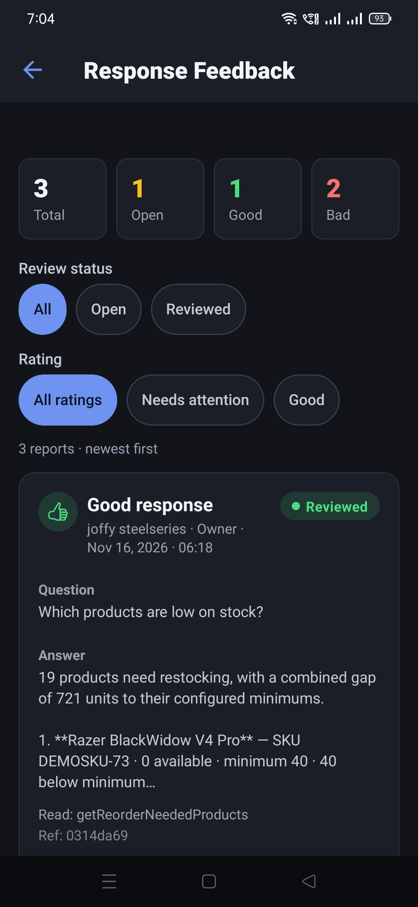

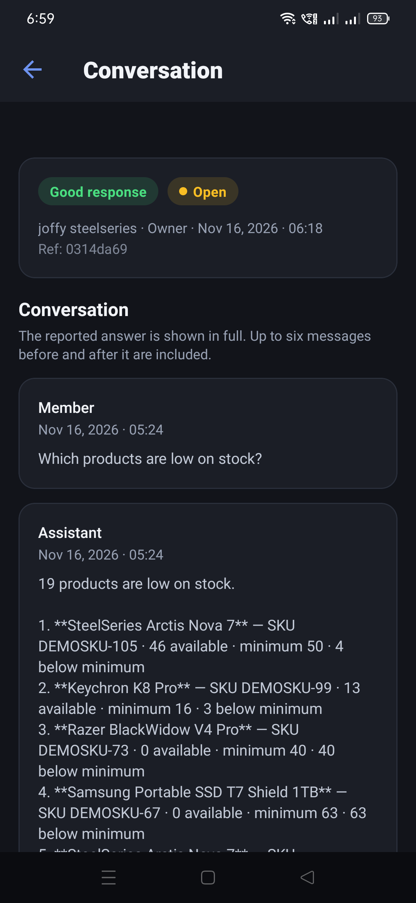

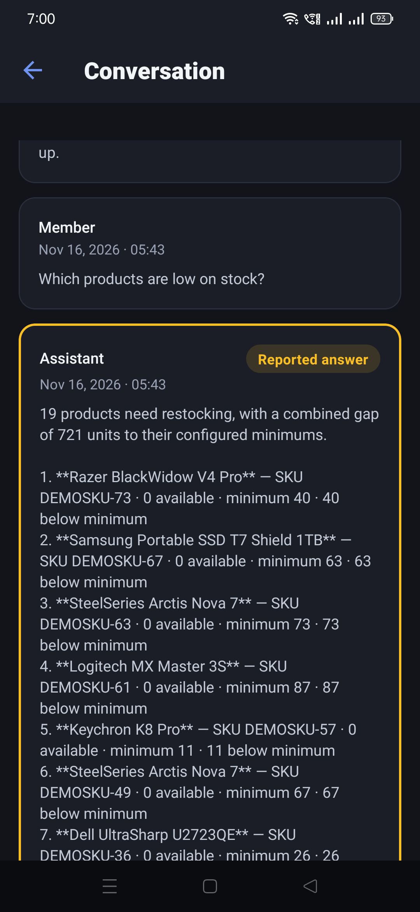

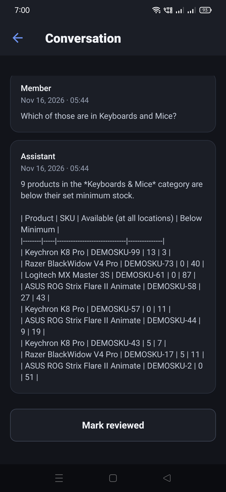

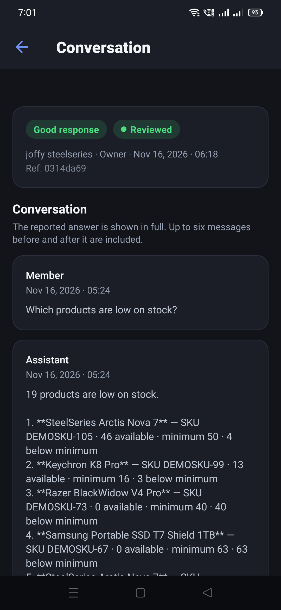

## 2. MANAGER and STAFF denial

Both temporary production accounts were signed in on the device and the feedback route was opened
through the app's deep link, `inventoryai://ai/feedback`.

| Account | Role shown in the app | Result |
| --- | --- | --- |
| `AI117 Manager` | Manager | **Not allowed** — “Only the business owner and admins can review assistant feedback.” |
| `AI117 Staff` | Staff | **Not allowed** — same role-denial screen |

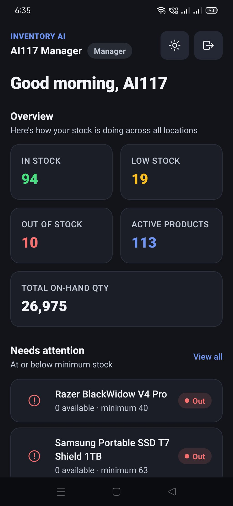

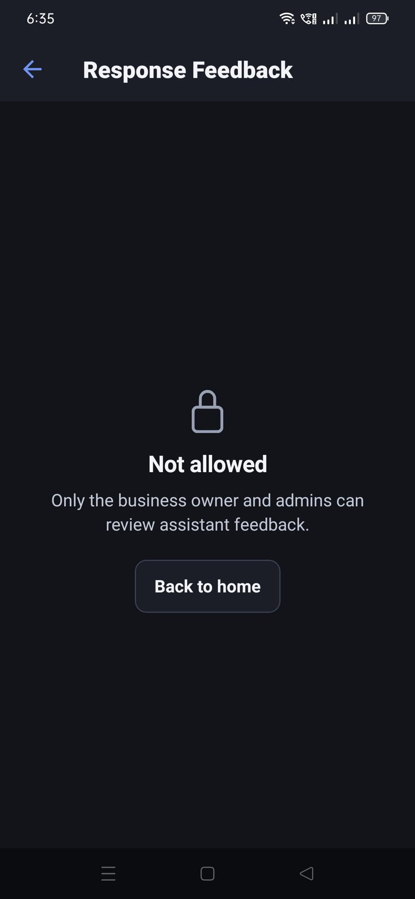

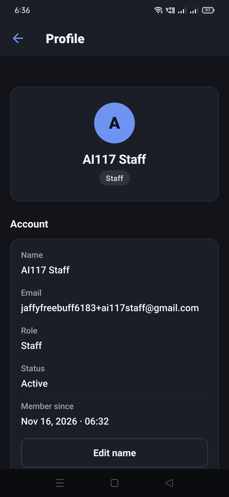

Both accounts were disabled after the pass, so the temporary credentials no longer work. The
password was never written to the repository or printed in the transcript.

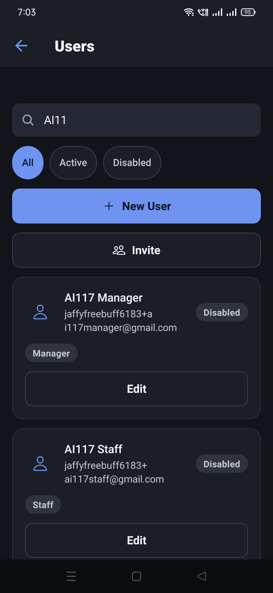

The server's business scoping and role checks are independently covered by
`AI117-ai-feedback-conversation.test.mjs` **4/4**: MANAGER/STAFF get `403`, another business gets
`404`, a deleted report is unreachable, and the queue remains excerpt-only.

## 3. Follow-up filters

The checks used a fresh low-stock conversation, then narrowed that answer without asking a new
question. Every Inspect panel named `Filtered previous results`, never a full fresh query.

| Step | Question | Answer | Inspect |
| --- | --- | --- | --- |
| Base low stock | “Which products are low on stock?” | **19 products** | `Tools: Low-stock products`, `Products: 19`, `Limit: 20` |
| Location | “Which of those are in Shop Front?” | **10 of the 19** low-stock products are at Shop Front; answer gives each product's available, minimum and below-minimum quantity | `Tools: Filtered previous results`, `Products: 10`, `Location: Shop Front`, `Limit: 50` |
| Out of stock | “Which of those are out of stock?” | **6 of 6** rows shown, all with `0 available` | `Tools: Filtered previous results`, `Products: 10`, `Location: Shop Front` |

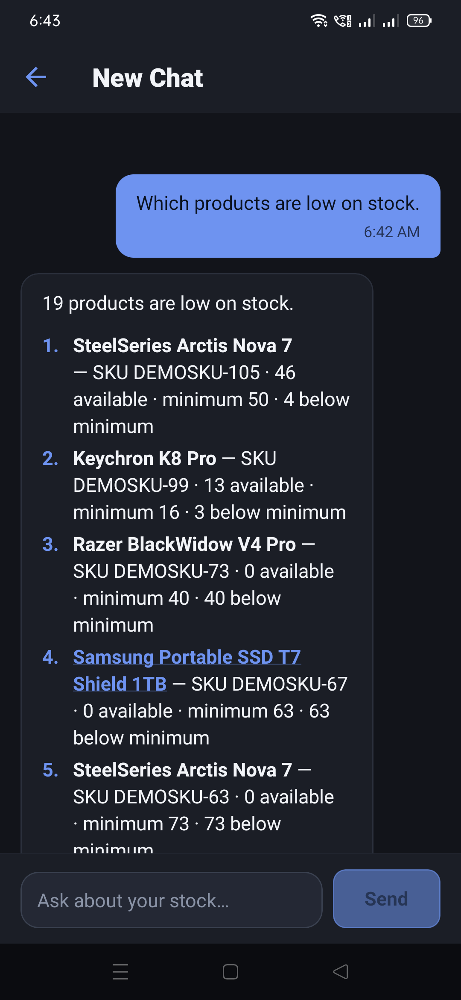

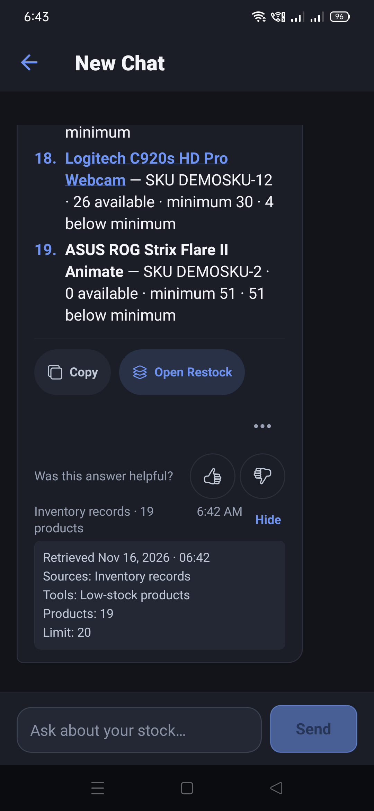

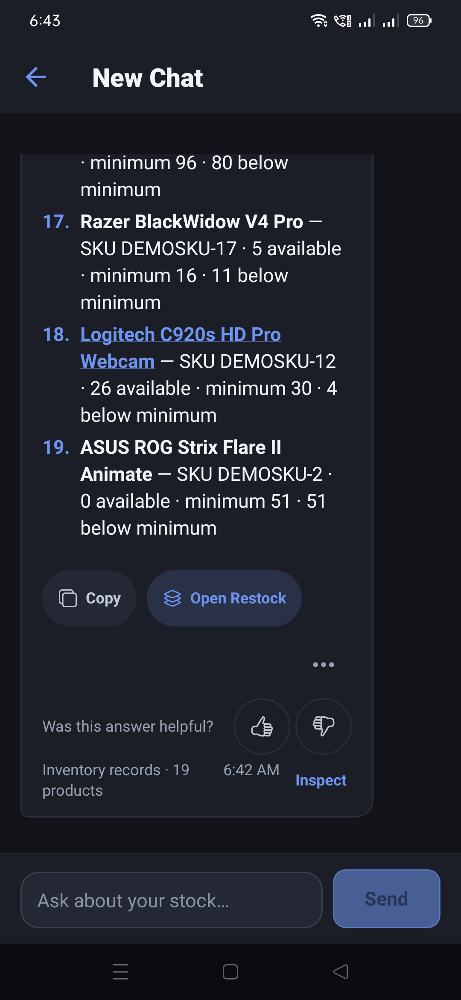

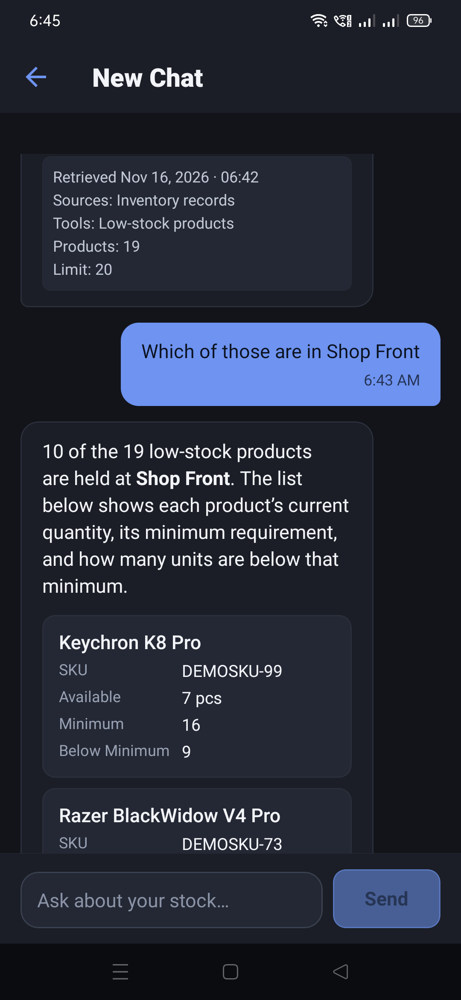

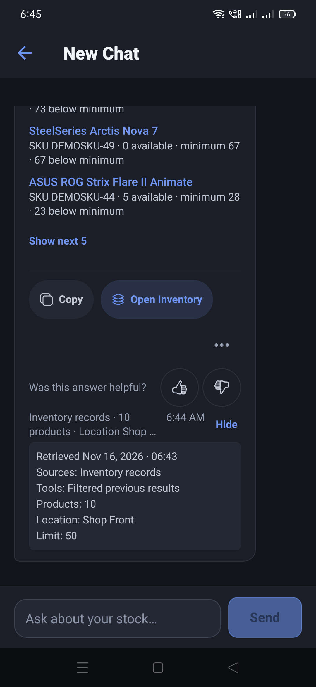

### Open finding: contradictory out-of-stock message

The out-of-stock filter produced the correct result set — “Showing 6 of 6”, six zero-quantity rows
— but the same answer card also displayed:

> I could not read that from your records just now. Please ask again — or open the Inventory
> screen to check it directly.

An earlier attempt at the same follow-up ended with the transient banner “The AI service is
temporarily unavailable” after a partial stream; a retry produced the six-row answer above. The
contradictory text is recorded as an open answer-composition defect, not a data leak: the rows
displayed are the correct six Shop Front products with zero available stock. The Inspect panel
still reports the previous context count (`Products: 10`), while the answer itself says `6 of 6`.

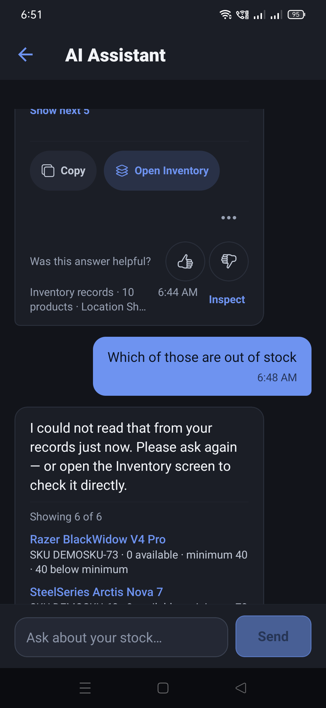

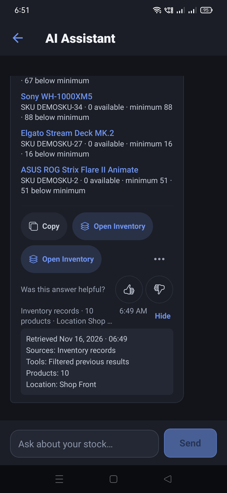

## Verification summary

| Check | Result |
| --- | --- |
| OWNER sees the full 19-line reported answer and surrounding messages | **PASS** |
| Reported answer is labelled and outlined | **PASS** |
| Review toggle changes the report to Reviewed and the queue reloads | **PASS** |
| MANAGER denied the feedback queue on the installed app | **PASS** |
| STAFF denied the feedback queue on the installed app | **PASS** |
| Temporary accounts disabled after the pass | **PASS** |
| Low-stock answer is complete and names the low-stock tool | **PASS** |
| Location follow-up narrows the previous set to Shop Front | **PASS** |
| Out-of-stock follow-up narrows to six zero-quantity rows | **PASS with finding** — contradictory failure sentence in the same card |

## Limits

- Android only; no iOS device is available.
- The device pass used the `rak gears` tenant. Cross-tenant isolation, deleted-report handling and
  role status codes were verified by the DB-backed server suite, not by a second signed-in business
  on the phone.
- The preview is deliberately a bounded window (up to six messages each side), not a transcript
  browser, and it shows the stored answer as plain text. Stored Markdown markers remain visible.
- The follow-up tests used the demo catalogue (`DEMOSKU-*`) and the existing `Shop Front` location.
  No inventory was changed; the assistant remained read-only.
- The out-of-stock wording finding has no code fix in this record.
