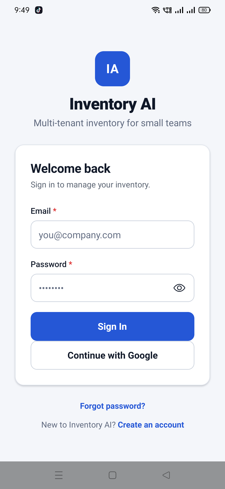
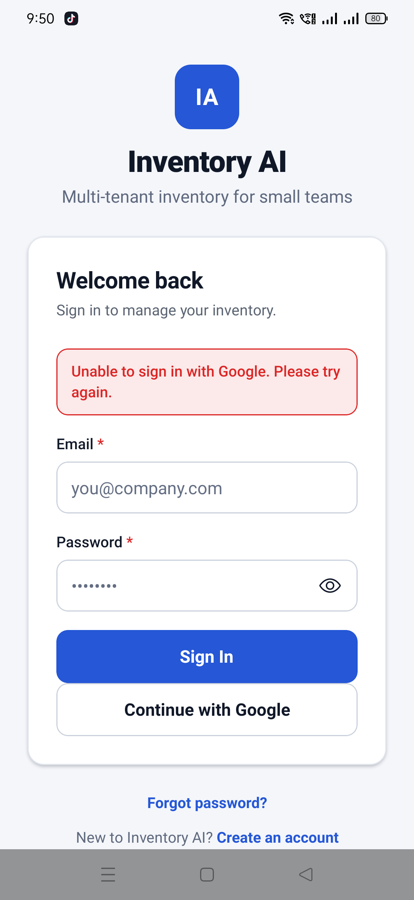

# Close-out evidence — 2026-11-11

Scope: the three approved follow-ups from the AI-106 close-out.

| Item | Result |
| --- | --- |
| Automatic GitHub schedule | **Not verified.** The replacement workflow is active and manually dispatchable, but GitHub still emitted zero `event=schedule` runs. |
| Standalone Android APK | **Built, installed and launched.** `com.inventoryai` is installed beside the untouched production `com.inventoryai.app`; the Ref line and What's New card are **not verified** because the standalone app is signed out. |
| Staging AI-105 retry | **Passed.** The real turn loop retried at 2,400 tokens with a 1,200-token reasoning budget and returned a readable answer. |

## 1. Scheduled production monitoring

PR #227 (`f440ed8`) offset the original cron and PR #228 (`1c7a1d8`) replaced the workflow file with
`Production health watch v2` (workflow ID `414656117`). GitHub reports the workflow as `active` on
`main`. The repository is public, not a fork or archived, Actions is enabled, and the only manual
run is a success:

```
gh run view 43022962990 --json event,status,conclusion,headSha
{"conclusion":"success","event":"workflow_dispatch","headSha":"1c7a1d8...","status":"completed"}
```

That manual run is a functional check, not schedule evidence. Repeated API checks of
`/actions/workflows/414656117/runs?event=schedule` returned:

```json
{"runs":[],"total_count":0}
```

The checks covered the period from the original workflow creation through 13:51Z, including the
v2 merge at 12:37Z and the 12:39, 12:44, 12:49 and later five-minute slots. The repository metadata,
default branch, Actions permissions, workflow state and owner-authored commit were all checked.
A disable/enable cycle on v2 also did not produce an event.

The GitHub community report for this exact symptom says there is no documented API to refresh
schedule registration and that missing many consecutive triggers points to a dispatcher/platform
issue; the documented fallback is an external scheduler calling the dispatch API. No external
scheduler or PAT was introduced in this task. **The automatic-schedule requirement remains
unverified and must not be marked complete.**

## 2. Standalone Android APK

### Root causes found

1. The original Windows build passed `-DCMAKE_OBJECT_PATH_MAX=1024`, but Ninja still failed to
   create a Reanimated directory whose path exceeded the legacy 260-character limit.
2. A `subst` drive mapped directly to `mobile` hid `package.json` from Expo autolinking because its
   upward search stops before the drive root. Mapping the subst drive to the repository root then
   produced mixed canonical roots (`this and base files have different roots`).
3. A real short-path copy at `C:\iab` cleared Reanimated. The next long path was the app's
   gesture-handler codegen; the effective app CMake cache had
   `CMAKE_OBJECT_PATH_MAX:UNINITIALIZED=250` after adding the app-level argument.
4. The standalone native project's Kotlin package was `com.inventoryai.app` while its namespace /
   applicationId were `com.inventoryai`. The temporary build copy aligned the namespace,
   applicationId and Kotlin sources to `com.inventoryai`; no production package was changed.

### Build and artifact

The clean short-copy build finished with:

```
BUILD SUCCESSFUL in 4m 41s
1013 actionable tasks: 47 executed, 966 up-to-date
```

The APK was copied to `mobile/build/standalone/app-release.apk` (local, ignored by Git):

```
package: name='com.inventoryai' versionCode='1' versionName='1.0'
minSdkVersion:'24'
targetSdkVersion:'36'
size: 38 MB
sha256: c315d4e6aa49b9df801cffc9eaf56c5100e0bf0ed44c41bc686b4fbb85c6de3e
signer: Android Debug, certificate SHA-256 fac61745dc0903786fb9ede62a962b399f7348f0bb6f899b8332667591033b9c
```

Install and coexistence check:

```
adb install -r mobile/build/standalone/app-release.apk
Success
adb shell pm list packages com.inventoryai
package:com.inventoryai
package:com.inventoryai.app
```

Production `com.inventoryai.app` remains versionCode 10 / versionName 1.0.2; it was not replaced or
modified. The standalone app launched `com.inventoryai/.MainActivity`.

### UI verification blocker

The launch screen is the sign-in screen:



The Google button produced the app's error, “Unable to sign in with Google. Please try again.”:



No credentials were entered and no account was created. Because the standalone app has no session,
the `Ref:` line and the What's New card were **not observed**. The APK is left installed for a
manual sign-in; this part of Task 2 is blocked, not passed.

## 3. Controlled staging AI-105 retry

`node scripts/staging-ai105-retry.mjs` exited 0 against a local stub OpenRouter endpoint, using
the real `runAiChat` turn loop. The observed request sequence was:

```json
[
  {"model":"openai/gpt-oss-20b","max_tokens":1200,"thinking":null},
  {"model":"openai/gpt-oss-20b","max_tokens":2400,"thinking":{"type":"enabled","budget_tokens":1200}}
]
```

The first response was empty at the output limit; the retry returned
“Staging retry produced a readable answer.” No production AI configuration or provider was changed.

## Verification commands

- `node scripts/staging-ai105-retry.mjs` — exit 0.
- `adb install -r mobile/build/standalone/app-release.apk` — Success.
- `adb shell pm list packages com.inventoryai` — both packages present.
- `gh api .../workflows/414656117/runs?event=schedule` — zero schedule runs.
- `node scripts/check-docs.mjs` and `git diff --check` — run after the documentation edit.
