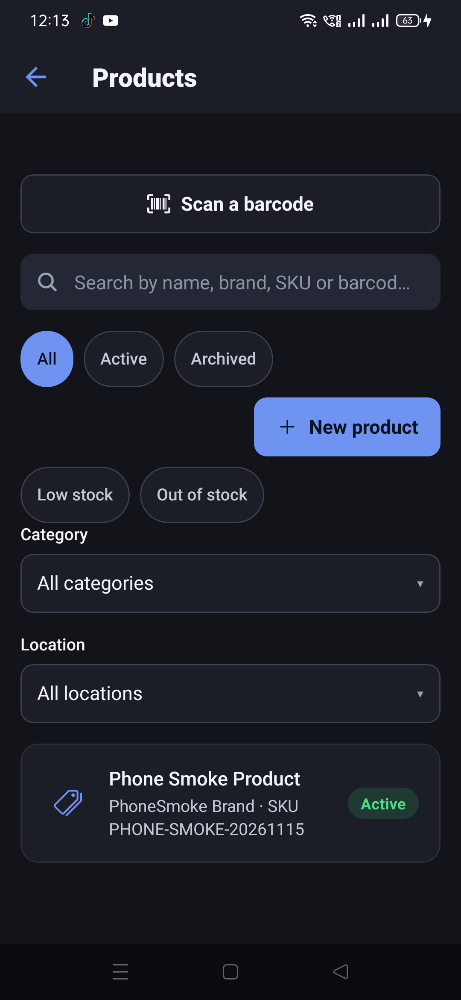
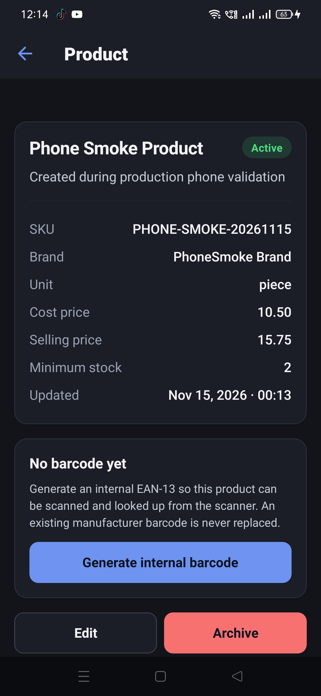
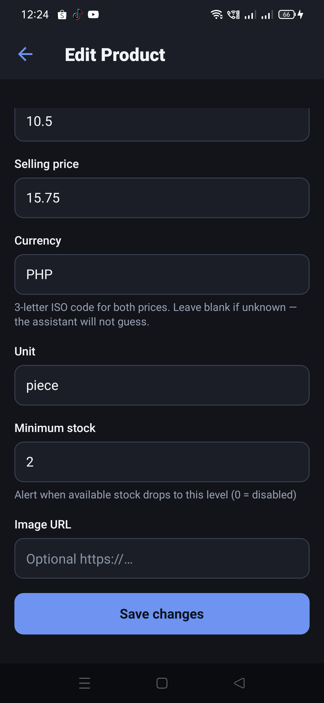
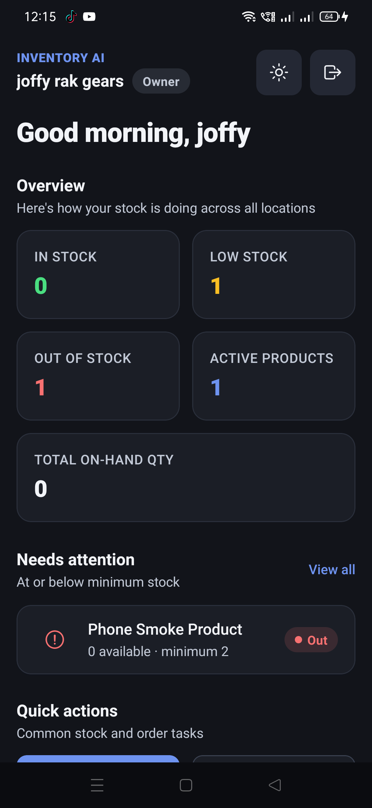
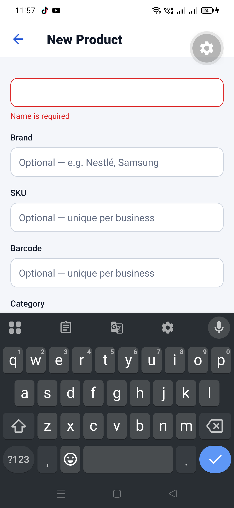
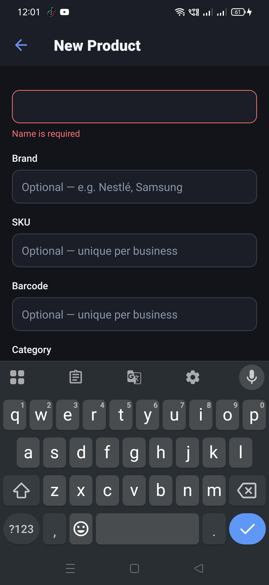

# Production product creation and required-name validation (2026-11-14)

This record covers the three production-testing follow-ups: creating one real product in the
production app, pinning the required-name behavior with an automated component test, and keeping the
development/production screenshots and OTA details together.

## 1. Product creation in production

**Account and app.** The designated production test account was the owner tenant `joffy rak gears`
on the production app `com.inventoryai.app`, version **1.0.2** (versionCode 10). The tenant held zero
products before this run.

**Test product.** The product was clearly labeled as test data:

| Field | Value |
| --- | --- |
| Name | `Phone Smoke Product` |
| Brand | `PhoneSmoke Brand` |
| SKU | `PHONE-SMOKE-20261115` |
| Description | `Created during production phone validation` |
| Cost price | `10.50` (read back as `10.5`) |
| Selling price | `15.75` |
| Currency | `PHP` |
| Unit | `piece` |
| Minimum stock | `2` |
| Stock | `0` |
| Status | `Active` |
| Barcode | None — intentionally left unset |

The form was submitted with **Create product** and the app returned to the Products list.

### Observed result

The product appeared in the Products list:



Opening it showed every entered field, with stock `0` and status `Active`:



Reopening **Edit** and scrolling to the price section read the values back from the API, including
the currency that the detail screen does not display:



The dashboard reflected the new product in all four summary values: **Active products 1**,
**In stock 0**, **Low stock 1**, **Out of stock 1**, and total on-hand quantity **0**. The product
card showed `0 available · minimum 2` and `Out`.



### Persistence

The production app was force-stopped and cold-started, then Products was opened again. The product
row was still present and its detail still showed the same name, brand, SKU, description, prices,
currency, unit, minimum stock and `Updated: Nov 15, 2026 · 00:13`:


That reload came from the production API after the app process was gone, so the row was stored
server-side rather than being retained in app memory. No direct MongoDB query was run from the
development host; the evidence is the production API's read-back after a cold start.

## 2. Required-name validation on the phone

### Development

The development APK (`com.inventoryai`, served by local Metro and the development API) reproduced
the original empty-form submit. After **Create product**, the name input took focus, the keyboard
opened, and `Name is required` was visible:



### Production OTA

PR **#278** ([link](https://github.com/nreffejzxc/inventory-ai/pull/278)) fixed the behavior and
squash-merged as commit **`a7be9cd43f25ceca8aaa1c6a47bcfbcff67626ac`**. All four required CI checks
passed before merge.

| OTA detail | Value |
| --- | --- |
| Branch | `production` |
| Runtime version | `1.0.2` |
| Platform | `android` |
| Update group | `2110458d-40ca-4975-813c-f182acb3e3aa` |
| Android update ID | `01a1dac9-0c80-7372-b8de-d63aba0cf62f` |
| Commit | `a7be9cd43f25ceca8aaa1c6a47bcfbcff67626ac` |

The publish output is preserved in [`ota-publish.txt`](ota-publish.txt). The production app was
retested with an empty form: the name field received focus, the keyboard opened, and the error was
visible at the same place as in development:



The same production session then passed the regression checks: Products empty/list state, dashboard
totals, and the AI assistant opening a thread with an answer.

## 3. Automated component test

PR **#279** ([link](https://github.com/nreffejzxc/inventory-ai/pull/279)) adds
`mobile/__tests__/product-form-required-name.test.tsx` and squash-merged as commit
**`6b6ef1f0ac41d44bd09268658bbe91023361f65c`**. It renders the real `ProductForm` with an empty name
and asserts that:

- `productsApi.create` is **not** called;
- the name field's focus handle is called; and
- `Name is required` is rendered.

The name `Input` is replaced by a small focusable stand-in so the test is specifically about
`ProductForm` requesting focus. The real `Input` ref forwarding remains covered by
`mobile/__tests__/keyboard-avoidance.test.tsx` and was verified on the phone by the production retest
above.

Local verification:

```text
npx jest __tests__/product-form-required-name.test.tsx --runInBand
  PASS  1 suite / 1 test

npm run typecheck
  passed

npm run lint
  passed
```

PR #279's four required GitHub checks passed: `server` 2m 59s, `mobile` 1m 17s, `secret-guard` 11s,
`attribution-guard` 7s.

## Limitations

- The product-creation and required-name checks were run on the OPPO `CPH1969` (Android 11); iOS was
  not tested.
- The production product was not deleted. It remains in the designated `joffy rak gears` tenant as
  the test record, with stock `0`.
- The component test stubs the visual `Input`; it proves the form calls the name field's focus
  handle, not that Android moves the cursor. The Android behavior is covered by the screenshots and
  by the earlier phone retest.
- These mobile and documentation changes did not change the production server; Render was not
  redeployed by PRs #278 or #279. Production served `cd4efcc` at the time of this record.
