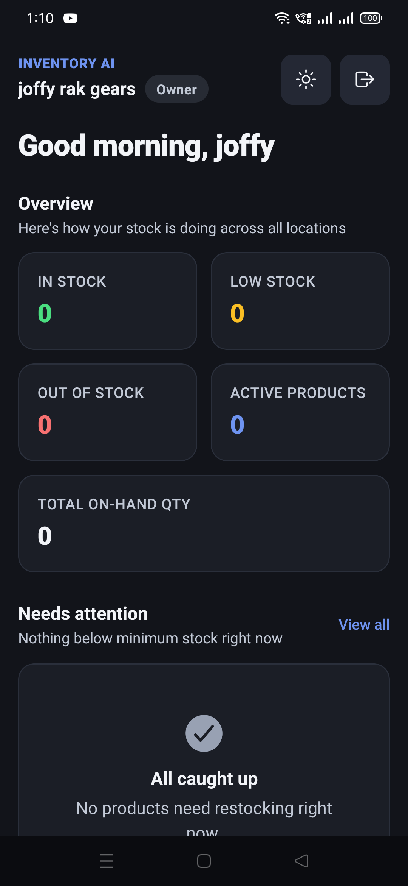

# Production sign-in and dashboard — P1 (2026-11-13)

The restored production app signed in with the owner's Google account and loaded the dashboard. This
was a read-only production check: no AI turn, no AI configuration change and no provider quota was
spent.

## What was checked

- Device: OPPO `CPH1969` (Android 11), owner user 0.
- App: `com.inventoryai.app` versionName **1.0.2**, versionCode **10** — the restored production APK.
- Sign-in: **Continue with Google**, owner account `jeffernmalinaoqwe@gmail.com` (the same identity
  named by the repository's commit email).
- Result: the dashboard rendered `joffy rak gears`, role **Owner**, with the Overview counts, the
  empty restock state and the bottom navigation.

The owner tenant currently has zero products, so the dashboard counts are all `0` and “Nothing below
minimum stock right now” is the correct empty state. The check proves authentication and the
dashboard request/render path; it does not prove a populated tenant.

## Production health at the same time

`GET /api/health` returned `status: ok`, `db: connected`, `environment: production`, commit
**`65d9ef1`**, 280 responses, 0 server errors and 0 `5xx`; `/api/health/ready` returned HTTP `200`.
The deployed commit is the checker/evidence merge, not an AI runtime change. Raw response:
[`production-health.json`](production-health.json).

## Limits

- This verifies sign-in and the empty dashboard, not a populated catalogue or an AI turn.
- It does not re-verify OTA delivery; the installed production binary is the APK restored after the
  dev-client run.
- Android only; iOS was not tested.
