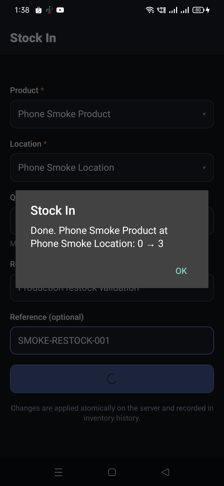
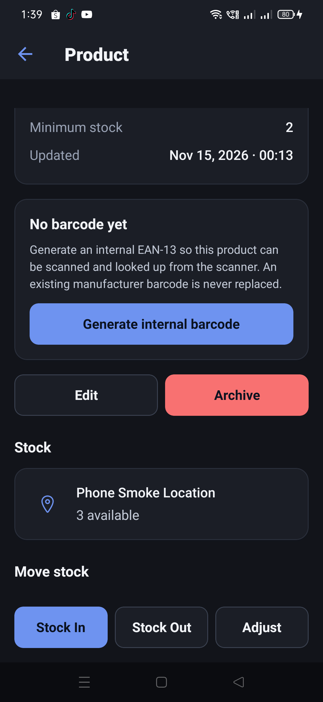
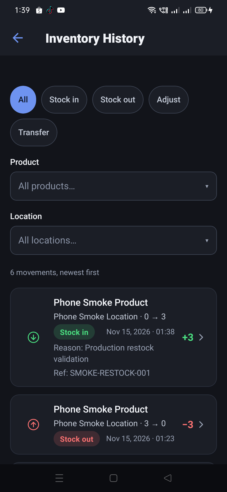
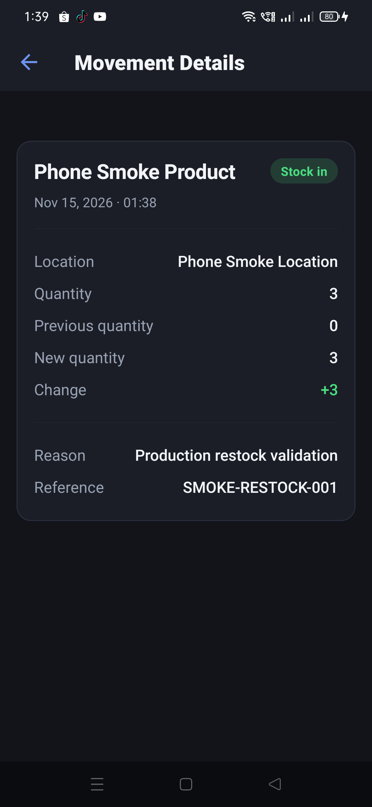
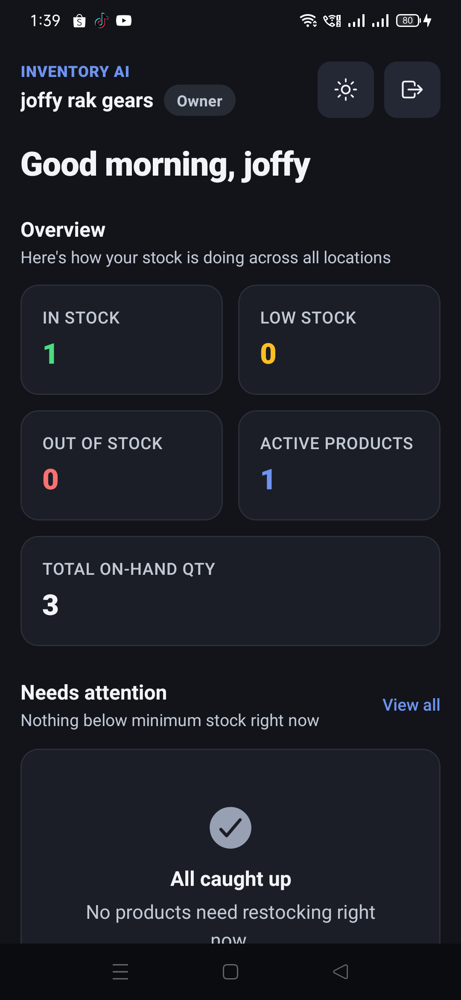

# Restock lifecycle check — 2026-11-14

Production server **`cb4fcf752c03fe138c8091761f6c2119fb6dfa9c`**. Android app on the enrolled
phone; tenant `joffy rak gears`; existing product `Phone Smoke Product` (`PHONE-SMOKE-20261115`,
minimum stock 2) at existing location `Phone Smoke Location`. No product or location was created.

Before this check the product had **0 units**, five movements, and was Out of Stock. This completes
the fixture's lifecycle: product creation → stock-in → stock-out → restock.

## Result

| Check | Expected | Observed |
| --- | --- | --- |
| Stock-in transaction | Succeeds with one new movement | **PASS** — `Done. Phone Smoke Product at Phone Smoke Location: 0 → 3` |
| Product detail | Quantity 3 and no longer Out | **PASS** — `3 available`; no Out badge; minimum stock 2 |
| Dashboard | Total 3; In stock 1; Low 0; Out 0 | **PASS** — exactly those values |
| Out of Stock count | Falls from 1 to 0 | **PASS** — **1 → 0** |
| Low Stock count | Falls from 1 to 0 once quantity exceeds minimum | **PASS** — quantity 3 is above minimum 2, so **Low stock 1 → 0** |
| History | One new +3 row, previous 0/new 3 | **PASS** — six movements; newest is `0 → 3` with the reason and reference |
| Cold restart | All three surfaces retain the same values | **PASS** — force-stop and cold start returned dashboard 3/1/0/0, detail `3 available`, and six movements |

## Restock

The existing product and location were selected in the **Stock In** form. Quantity **3**, reason
`Production restock validation`, reference `SMOKE-RESTOCK-001`, then **Add stock**:

> Done. Phone Smoke Product at Phone Smoke Location: 0 → 3

## Before and after

| Surface | Before restock | After restock |
| --- | --- | --- |
| Product detail | `0 available`, **Out** | `3 available`, no Out badge |
| Dashboard active products | 1 | 1 |
| Dashboard in stock | 0 | **1** |
| Dashboard low stock | 1 | **0** |
| Dashboard out of stock | 1 | **0** |
| Dashboard total on-hand | 0 | **3** |
| History | 5 movements | **6 movements** |

The out-of-stock and low-stock counts both fell to zero because the new quantity, 3, is above the
product's minimum of 2. The product detail's price values were unchanged (`10.50` cost, `15.75`
selling).

## History and movement record

Inventory History showed **six movements**, newest first. The new top row was `Phone Smoke Location ·
0 → 3`, **Stock in**, `+3`, reason `Production restock validation`, reference
`SMOKE-RESTOCK-001`:

Its movement detail read previous quantity **0**, new quantity **3**, change **+3**, stock in,
`Phone Smoke Product`, `Phone Smoke Location`, the reason, reference and timestamp:

## Cold-restart consistency

The app was force-stopped, then cold-started directly into the dashboard. The first load came from
the production API with the app process gone:

- dashboard: active **1**, in stock **1**, low **0**, out **0**, total on-hand **3**;
- product detail: `3 available`, minimum 2, no Out badge;
- history: **6 movements**, newest `0 → 3`, reference `SMOKE-RESTOCK-001`.

## Production health

`GET /api/health` at 17:40Z reported `status: ok`, `db: connected`, environment `production`,
commit `cb4fcf752c03fe138c8091761f6c2119fb6dfa9c`, **0** server errors and **0** `5xx` responses.
`GET /api/health/ready` returned **200**. Complete bodies:
[`health.json`](health.json) and [`ready.json`](ready.json).

## Limits

- Android only; no iOS device.
- The evidence is the production app/API read-back, not a direct MongoDB query.
- The test product is left at **3 units**, healthy and above its minimum, with six movements.
- No code, configuration or AI model changed; no OTA was published.
