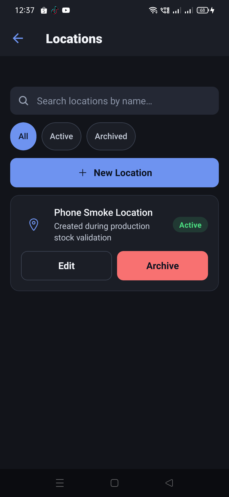
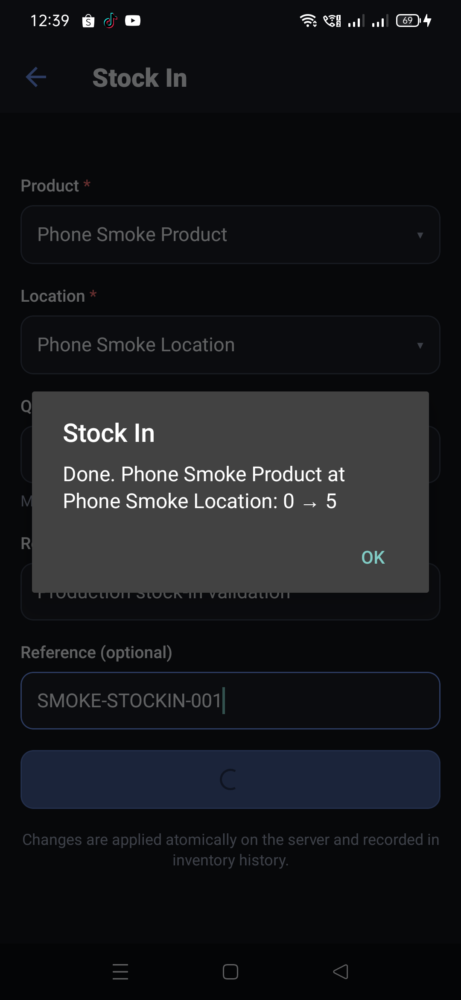
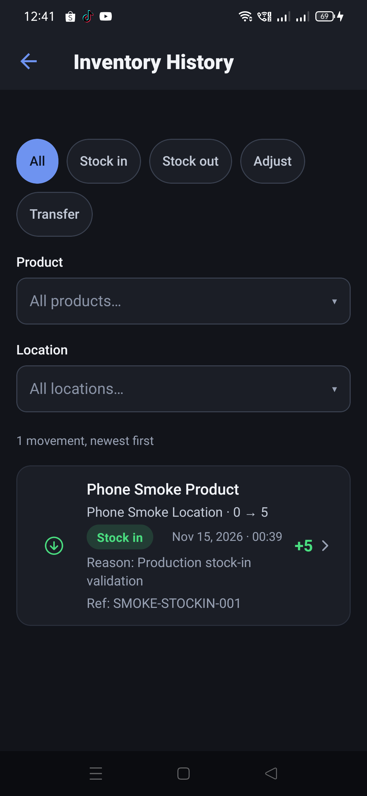
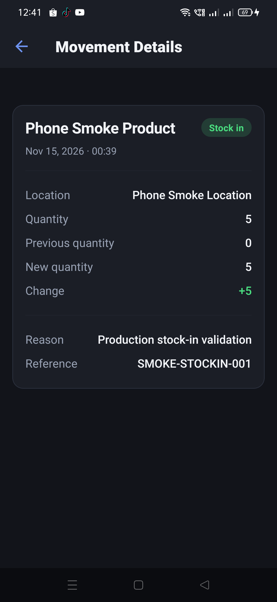
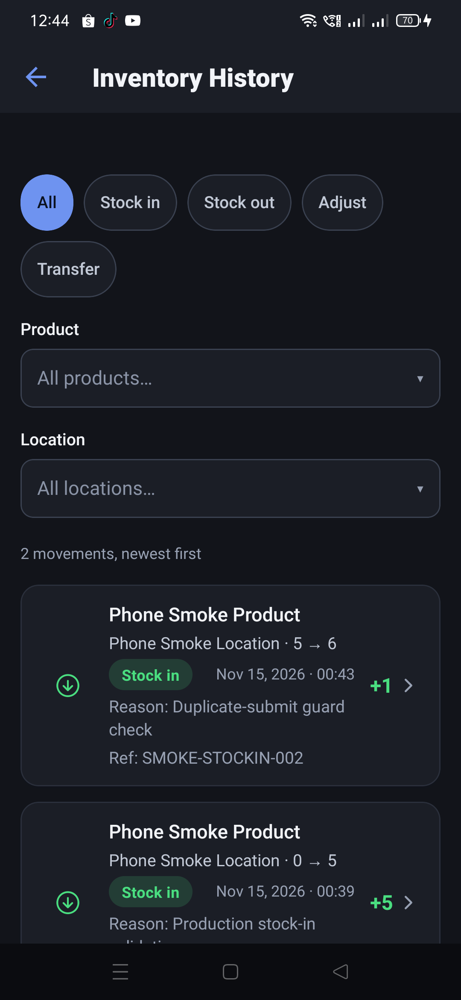
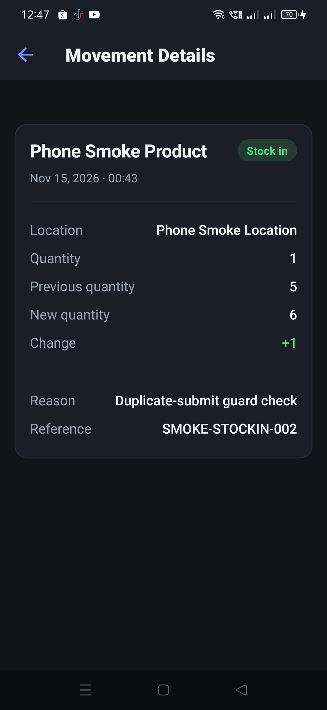
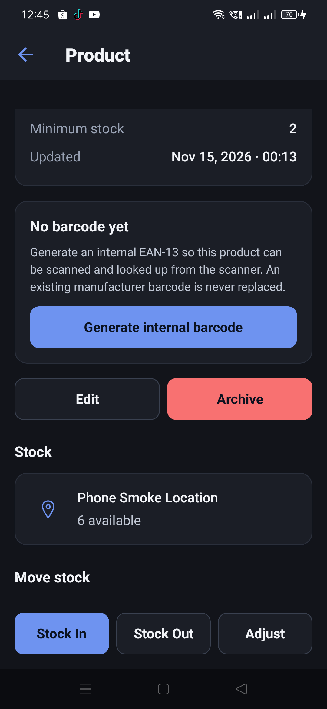
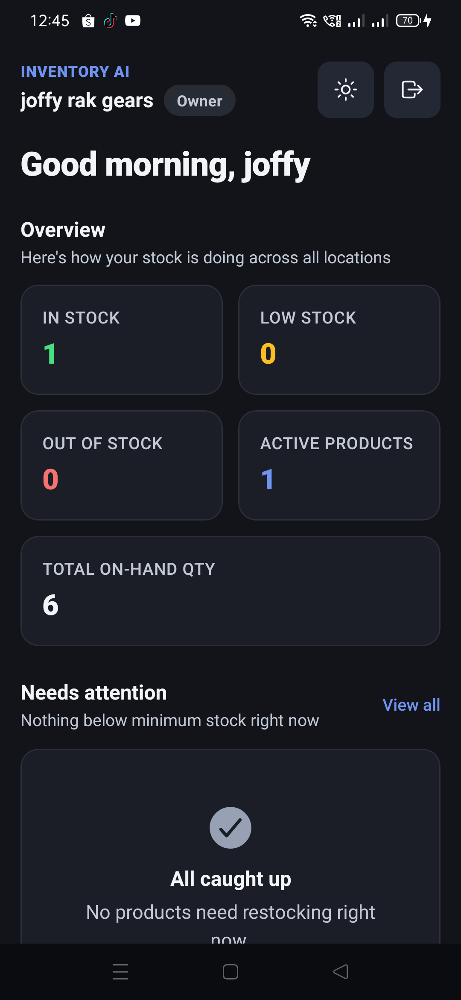
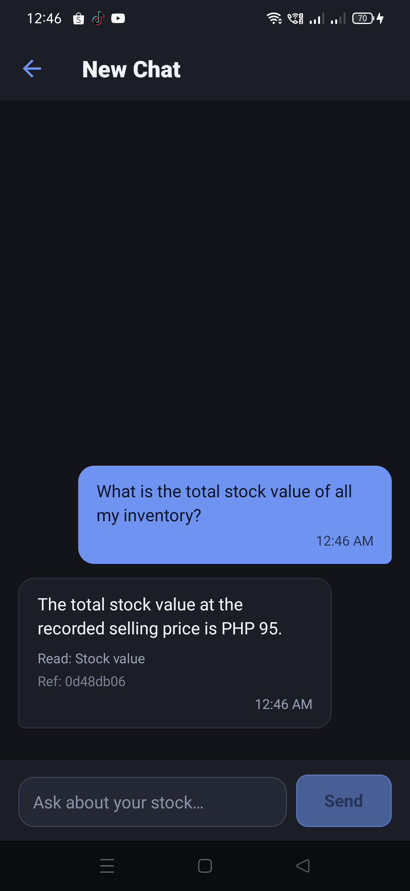

# Production stock-in, duplicate guard and stock-value check (2026-11-14)

This record continues the production test from
[`product-creation-name-focus-2026-11-14`](../product-creation-name-focus-2026-11-14/README.md). It
uses the same designated tenant (`joffy rak gears`), production app `com.inventoryai.app` 1.0.2
(versionCode 10) and test product `Phone Smoke Product`.

## Setup: one test location

The tenant had no locations, so the stock-in form had nothing to select. One clearly labeled test
location was created:

| Field | Value |
| --- | --- |
| Name | `Phone Smoke Location` |
| Description | `Created during production stock validation` |
| Status | `Active` |

## First stock-in: 5 units

The stock-in form was filled with:

| Field | Value |
| --- | --- |
| Product | `Phone Smoke Product` |
| Location | `Phone Smoke Location` |
| Quantity | `5` |
| Reason | `Production stock-in validation` |
| Reference | `SMOKE-STOCKIN-001` |

The confirmation alert read:

> Done. Phone Smoke Product at Phone Smoke Location: 0 → 5

After **OK**, the dashboard read **Active products 1**, **In stock 1**, **Low stock 0**,
**Out of stock 0**, total on-hand **5**; the product card had moved out of the "needs attention"
section.

The product detail showed `Phone Smoke Location — 5 available`:

Inventory History showed **1 movement**, `+5`, `Nov 15, 2026 · 00:39`,
`Phone Smoke Location · 0 → 5`, with the reason and reference:

Opening the movement showed **Quantity 5**, **Previous quantity 0**, **New quantity 5**,
**Change +5**, the location, reason, reference and timestamp:

## Duplicate-submit check: 1 unit, pressed twice

A second legitimate movement used quantity `1`, reason `Duplicate-submit guard check` and reference
`SMOKE-STOCKIN-002`. The **Add stock** button was pressed twice in immediate succession.

The single confirmation read:

> Done. Phone Smoke Product at Phone Smoke Location: 5 → 6

It did **not** read `5 → 7`. There was one new movement and one new history row, not two.

After a force-stop and cold start, Inventory History read **2 movements**:

- `+1`, `Nov 15, 2026 · 00:43`, `Phone Smoke Location · 5 → 6`,
  `Reason: Duplicate-submit guard check`, `Ref: SMOKE-STOCKIN-002`
- `+5`, `Nov 15, 2026 · 00:39`, `Phone Smoke Location · 0 → 5`,
  `Reason: Production stock-in validation`, `Ref: SMOKE-STOCKIN-001`

The latest movement detail showed quantity **1**, previous **5**, new **6**, change **+1**, and the
expected reason and reference:

This is a double-press check at the app's submit guard. The server's same-`Idempotency-Key` replay
protection is covered by `server/test/INVENTORY-IDEMPOTENCY.test.mjs`; that suite was not rerun in
this session.

## Final consistency

The three stock surfaces agreed at **6 units**:

- Product detail: `Phone Smoke Location — 6 available`.
- Dashboard: **Active products 1**, **In stock 1**, **Low stock 0**, **Out of stock 0**, total on-hand
  **6**.
- Inventory History: two movements, `0 → 5` then `5 → 6`.

## Stock value

One production assistant question was asked: “What is the total stock value of all my inventory?”
The answer was:

> The total stock value at the recorded selling price is PHP 95.

with `Read: Stock value` and `Ref: 0d48db06`.

The recorded selling price is `PHP 15.75` and the available quantity is `6`, so the exact value is
`15.75 × 6 = 94.50`. The answer's `PHP 95` is the rounded display: the server's `money()` helper uses
`Intl.NumberFormat('en-PH', { maximumFractionDigits: 0 })` before adding the currency code. The
underlying product calculation is consistent; the rendered answer loses the centavos. If exact
centavos are required in stock-value answers, that formatter needs a follow-up change.

## Limits

- Android only; iOS was not tested.
- The evidence is the production API's read-back after a cold start, not a direct MongoDB query.
- The duplicate check is one immediate double press. It verifies the UI guard prevents a second
  request; it cannot prove how the server handles two genuinely duplicated HTTP deliveries on this
  run.
- The stock-value answer verifies the tool-grounded total and exposes a display-rounding issue; it is
  not a direct read of the stored ledger.
- The test product and test location remain in the designated production tenant. The product has
  **6 units** on hand at the end of this run.
