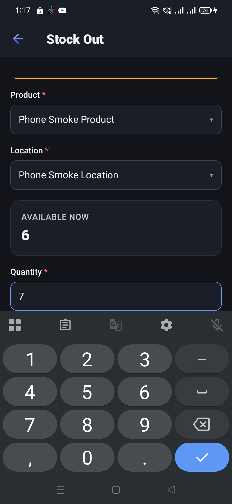
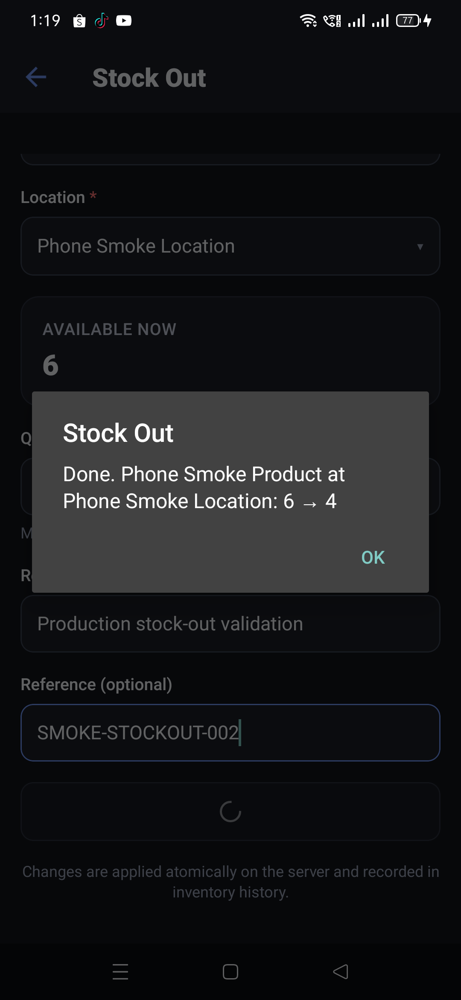
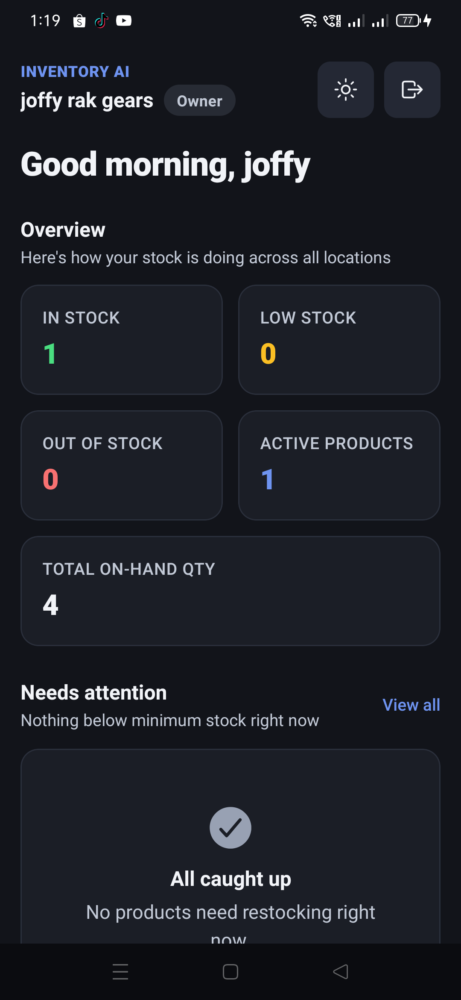
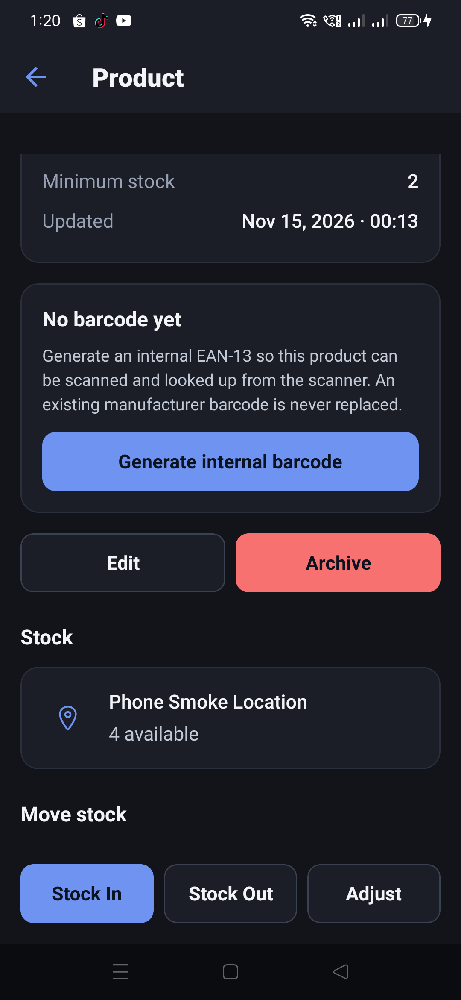
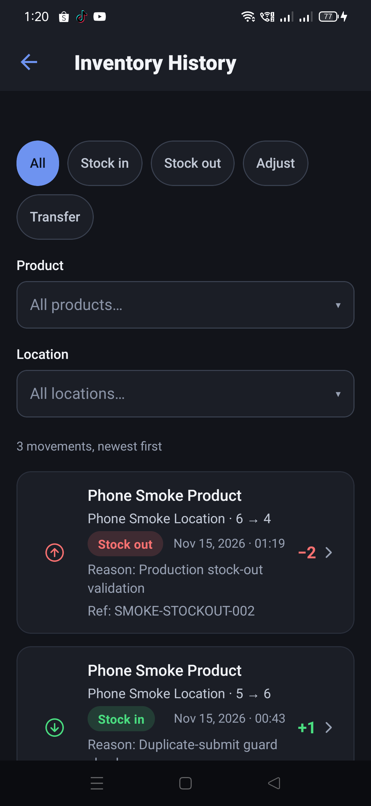
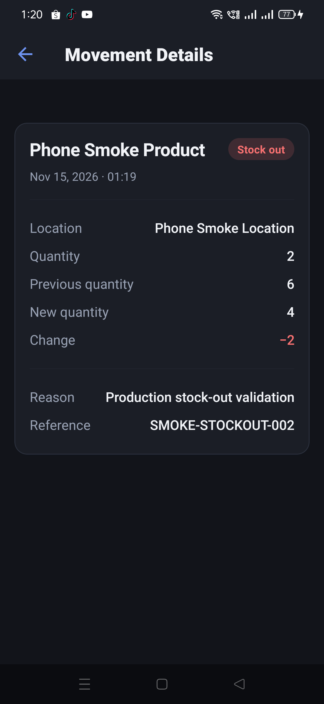
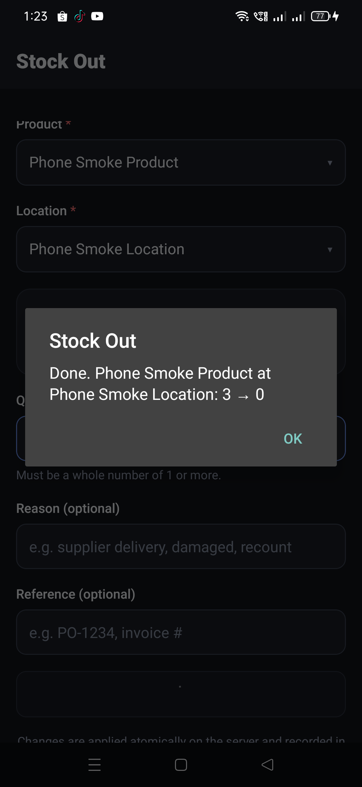
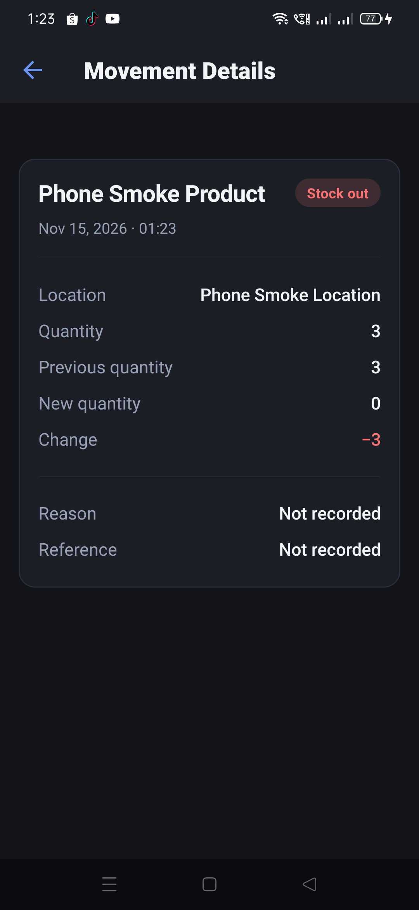
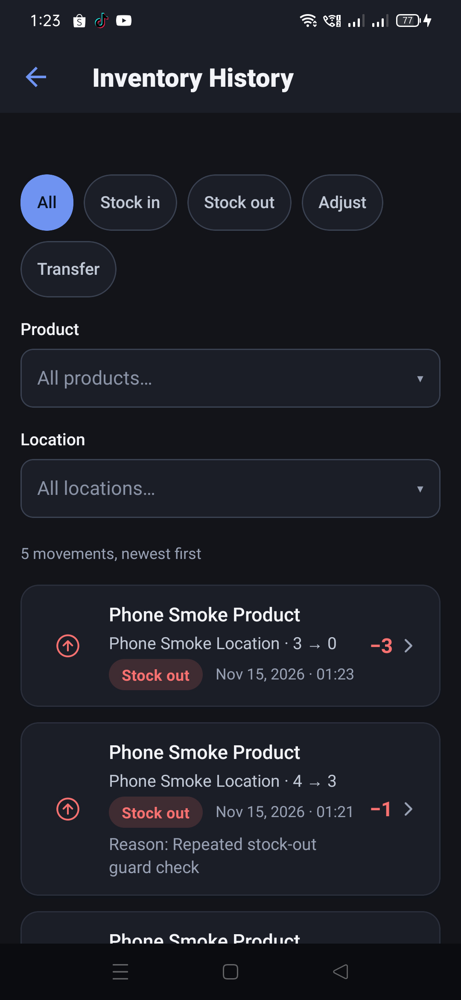
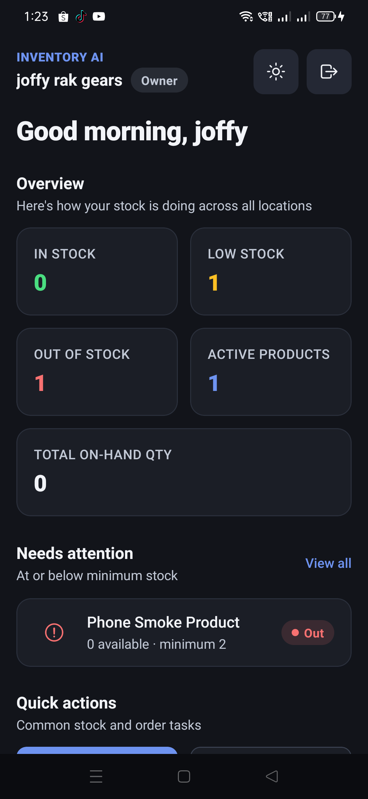

# Stock-out and negative-stock production test — 2026-11-14

Production server **`cb4fcf752c03fe138c8091761f6c2119fb6dfa9c`**. Android app on the enrolled
phone; tenant `joffy rak gears`; product `Phone Smoke Product` (`PHONE-SMOKE-20261115`), minimum
stock 2, at `Phone Smoke Location`. Before this test the product had **6 units** and two stock-in
rows in Inventory History.

The production server was unchanged by this test. No OTA was published.

## Results

| Check | Expected | Observed |
| --- | --- | --- |
| Stock-out 7 from 6 | Refused; stock stays 6; no new movement | **PASS** — the form showed `Only 6 available — the server will not let stock go below zero.` and disabled **Remove stock**; history stayed at 2 rows and stock stayed at 6 |
| Valid stock-out 2 | 6 → 4, with one −2 row | **PASS** — alert `Done. Phone Smoke Product at Phone Smoke Location: 6 → 4`; dashboard total 4; product detail `4 available`; history gained one `−2` row |
| Repeated stock-out at the boundary | One decrement, never negative | **PASS** — the **Remove stock** button was pressed twice in immediate succession for 3 units against 3 available; alert `3 → 0`, history gained exactly one `−3` row, final stock 0 |
| Simultaneous guard (server) | No oversell | **PASS** — focused test below: four concurrent 3-unit stock-outs against 10 stock gave 3 accepted, 1 `409 INSUFFICIENT_STOCK`, final stock 1 and 3 ledger rows |

## Negative-stock attempt

With 6 units available, the stock-out form was given quantity **7** for `Phone Smoke Product` at
`Phone Smoke Location`. The form displayed:

> Only 6 available — the server will not let stock go below zero.

and **Remove stock** was disabled. No movement appeared in history, and the product still read 6.



The client therefore prevents the over-stock submission before it is sent. The server's own guard is
covered by `server/test/phase04-inventory.test.mjs` and the focused concurrency run below.

## Valid stock-out

A 2-unit stock-out with reason `Production stock-out validation` and reference
`SMOKE-STOCKOUT-002` returned:

> Done. Phone Smoke Product at Phone Smoke Location: 6 → 4



Dashboard: **Active products 1**, **In stock 1**, **Low stock 0**, **Out of stock 0**, total on-hand
**4**. Product detail: `4 available`. Both agreed with the movement.





Inventory History showed three movements, newest first, with the `−2` row carrying the reason and
reference:



The movement detail read **previous quantity 6**, **new quantity 4**, **change −2**, stock out,
`Phone Smoke Location`, `Production stock-out validation`, `SMOKE-STOCKOUT-002`, and the movement
timestamp:



## Repeated-request boundary test

A one-unit stock-out (`4 → 3`) was recorded while preparing the boundary test; the form's layout
shifted after the keyboard closed and the automation's next tap landed on **Remove stock** instead
of the optional reference field. It is a legitimate, single movement, reason `Repeated stock-out
guard check`, with no reference. It is included in the final history rather than hidden.

With **3 units** available, quantity **3** was entered and **Remove stock** was pressed twice in
immediate succession. The app returned one confirmation:

> Done. Phone Smoke Product at Phone Smoke Location: 3 → 0

History grew from four rows to **five**, with exactly one new `−3` row, so the repeated press did
not apply a second movement. Stock ended at **0**, not a negative number.



The movement detail read previous quantity **3**, new quantity **0**, change **−3**, stock out,
and the same location and timestamp class as the other production movements:





## Final dashboard and product detail

At zero stock the dashboard showed **Active products 1**, **In stock 0**, **Low stock 1**,
**Out of stock 1**, and total on-hand **0**; the product row read `0 available · minimum 2`, `Out`.



Product detail read `0 available`, with `Out` and no negative quantity:


The `Low stock 1` and `Out of stock 1` values overlap deliberately: §19 defines low as
`availableQuantity <= minimumStock` and out as `availableQuantity <= 0`, so a zero-stock product is
in both dashboard sets. The same overlap is stated in the specification and pinned by
`server/test/SCALE-dashboard-counts.test.mjs`; it is not a new regression. It does mean the tiles are
not mutually exclusive when zero-stock and low-stock counts are read together.

## Simultaneous guard

The production UI check above covers one immediate double press. The server's atomic availability
guard was rerun against the test database:

```text
TEST_MODE=db node --test --test-name-pattern="concurrent stock-outs never oversell" \
  test/phase04-inventory.test.mjs
```

Result: **1 pass, 0 fail**. The test starts with 10 units and issues four concurrent 3-unit
stock-outs; it asserts **3 × 200**, **1 × 409 `INSUFFICIENT_STOCK`**, final quantity **1**, and
exactly **3** `STOCK_OUT` ledger rows. This is the simultaneous case; the production phone test is
the repeated-press case.

## Production health

`GET /api/health` at 17:26Z reported `status: ok`, `db: connected`, environment `production`,
commit `cb4fcf752c03fe138c8091761f6c2119fb6dfa9c`, **0** server errors and **0** `5xx` responses.
`GET /api/health/ready` returned **200**. The complete bodies are in [`health.json`](health.json)
and [`ready.json`](ready.json).

## Limits

- Android only; no iOS device.
- The production test was driven through the app UI; it was not a direct database query.
- The seven-unit attempt was stopped by the form's availability guard, so the production server's
  `409` path was not exercised by that tap. The server path is covered by the focused concurrent
  test and the existing inventory suite.
- The test product is left at **0 units** (`Out`), with five movements in history: two stock-ins and
  three stock-outs.
