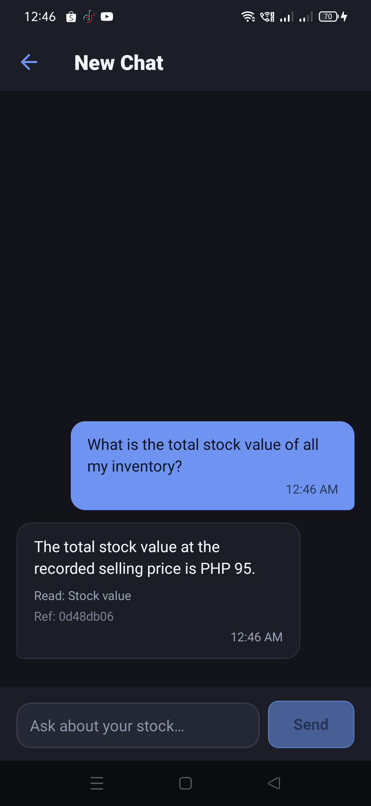
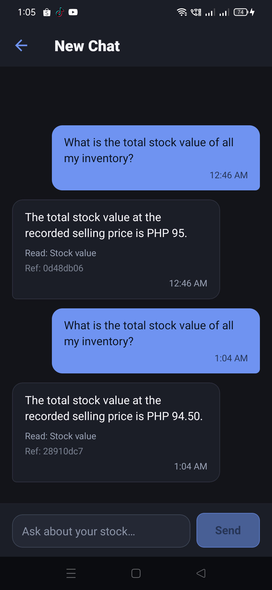

# Stock-value answer keeps centavos (2026-11-14)

## The defect

The production assistant answered the stock-value question for the 6-unit test product as:

> The total stock value at the recorded selling price is PHP 95.

The exact value is `15.75 × 6 = 94.50`. The stock-value calculation was correct; the finalizer's
`money()` helper formatted every amount with `Intl.NumberFormat('en-PH', { maximumFractionDigits: 0 })`,
so the centavos were rounded away.



## The change

Only the display formatter in `server/src/services/ai/answerCompletion.ts` changed:

- round the amount to cents;
- render a fractional amount with exactly two decimals (`PHP 94.50`);
- keep a whole-peso amount compact (`PHP 95`, `PHP 12,345`).

The underlying `productService.stockValue()` calculation, its quantity/price inputs, the AI model
configuration and the mobile application were **not** changed. This is a server-only change, so no
OTA was published.

## Regression coverage

`server/test/AI93-routing-total-and-evidence.test.mjs` now asserts:

- `94.5` with currency `PHP` → `PHP 94.50`;
- `95` with currency `PHP` → `PHP 95`;
- the combined total/highest-value answer renders `PHP 94.50` for both the total and the recorded
  selling price.

Local checks:

```text
node --test test/AI93-routing-total-and-evidence.test.mjs
  13 tests, 13 pass, 0 fail

npm run typecheck
  passed

npm run lint
  passed
```

## Delivery and deployment

PR **#282** squash-merged as **`cb4fcf752c03fe138c8091761f6c2119fb6dfa9c`**. All four required
checks passed: `server` 3m 10s, `mobile` 1m 34s, `secret-guard` 11s, `attribution-guard` 10s.

Render auto-deployed the server commit. `/api/health` reported:

```json
{"status":"ok","db":"connected","environment":"production",
 "commit":"cb4fcf752c03fe138c8091761f6c2119fb6dfa9c",
 "uptimeSeconds":96,"counters":{"responses":24,"byStatusClass":{"2xx":24,"5xx":0},
 "serverErrors":0}}
```

`/api/health/ready` returned `{"status":"ready","db":"connected"}`. Raw responses are in
[`health.json`](health.json) and [`ready.json`](ready.json).

## Production retest

The same question was sent again from the production app. The new answer was:

> The total stock value at the recorded selling price is PHP 94.50.

`Read: Stock value`, `Ref: 28910dc7`. The earlier `PHP 95` answer (`Ref: 0d48db06`) remains visible in
the same thread above it.



## Limits

- This retest covers one product, six units and one currency (`PHP`); it does not exercise
  mixed-currency or multi-product totals.
- The production answer is an AI turn over the live stock-value tool, not a direct database read.
- Android only; the server-side formatter is platform-independent, but no iOS device was tested.
- No AI model or provider configuration was changed.
