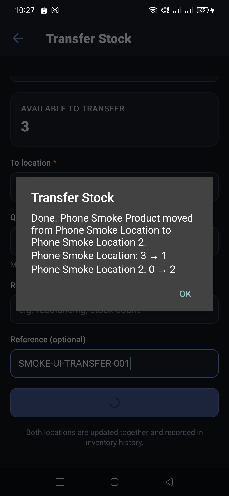
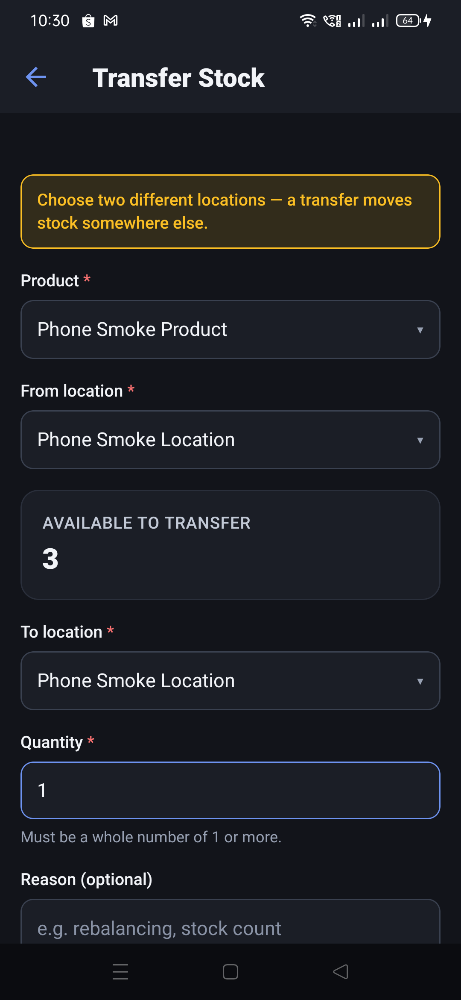
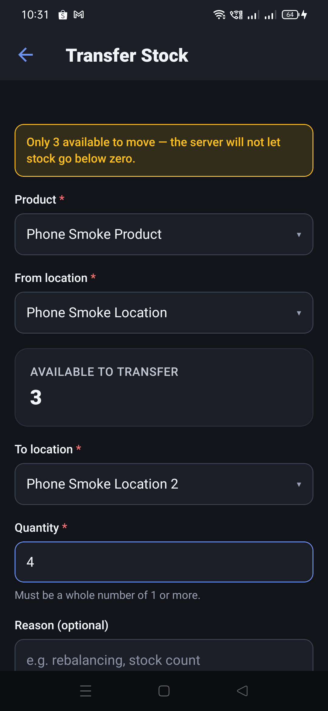
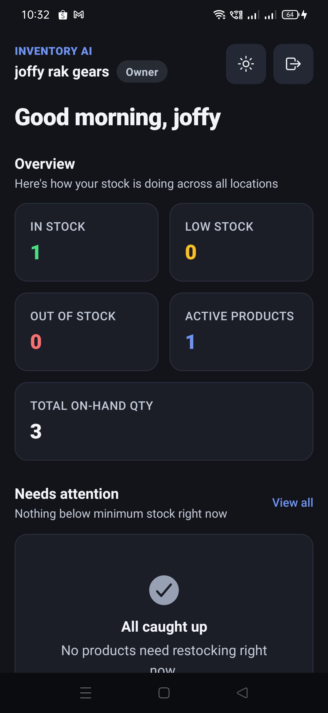

# Installed-app transfer checks and inventory write-path audit — 2026-11-15

Production server **`996e49b88a77d3702bb2413cf94f8a43e306954c`**, deployed from PR #287 at
02:24Z. The installed app is **`com.inventoryai.app` 1.0.2** (`versionCode` 10) on a CPH1969
Android device, signed in as the owner of the test tenant `rak gears`.

Only `Phone Smoke Product` (`PHONE-SMOKE-20261115`) and the two test locations were used:
`Phone Smoke Location` and test-only `Phone Smoke Location 2`. No operational location or
inventory was touched.

## Installed-app checks

The forward transfer was required to give the reverse transfer something to move; the reverse
then restored the fixture. Both were submitted through the real form, not the API.

| Step | UI result | Ledger |
| --- | --- | --- |
| Forward, quantity 2, `SMOKE-UI-TRANSFER-001` | `3 → 1` at `Phone Smoke Location`; `0 → 2` at `Phone Smoke Location 2` | Two `TRANSFER` rows, one per location |
| Reverse, quantity 2, `SMOKE-UI-TRANSFER-002` | `2 → 0` at `Phone Smoke Location 2`; `1 → 3` at `Phone Smoke Location` | Two `TRANSFER` rows, one per location |
| Same-location attempt | Warned: **“Choose two different locations — a transfer moves stock somewhere else.”** Submit button disabled | No row, no movement |
| Over-quantity attempt, quantity 4 against 3 available | Warned: **“Only 3 available to move — the server will not let stock go below zero.”** Submit button disabled | No row, no movement |








The final dashboard read **In stock 1**, **Low stock 0**, **Out of stock 0**, **Active products 1**
and **Total on-hand qty 3**.



The production ledger read back **14 movements**, of which **8** are `TRANSFER` rows. Each UI
reference has exactly two rows:

| Reference | Location | Quantity | Previous | New |
| --- | --- | --- | --- | --- |
| `SMOKE-UI-TRANSFER-001` | `Phone Smoke Location` | 2 | 3 | 1 |
| `SMOKE-UI-TRANSFER-001` | `Phone Smoke Location 2` | 2 | 0 | 2 |
| `SMOKE-UI-TRANSFER-002` | `Phone Smoke Location 2` | 2 | 2 | 0 |
| `SMOKE-UI-TRANSFER-002` | `Phone Smoke Location` | 2 | 1 | 3 |

Final stock: **3 at `Phone Smoke Location`, 0 at `Phone Smoke Location 2`, total 3**. There are
**0** rows whose reference contains `SAME` or `OVER`. Full read-only output: [`state.json`](state.json).
Production health at deployment: [`health.json`](health.json), [`ready.json`](ready.json).

## Other inventory write paths

Review scope: every route that can change inventory quantity, plus purchase-order receiving.

| Path | Atomic write / ledger | Duplicate-request protection | Evidence |
| --- | --- | --- | --- |
| Stock in | Upsert inventory row with atomic `$inc`; one `STOCK_IN` transaction; audit failure is logged, transaction failure compensates the row | `idempotent()` on `POST /api/inventory/stock-in`; mobile always sends a key | 4 idempotency cases; Phase 04 and 07A |
| Stock out | Conditional `available >= quantity` guard and atomic `$inc`; one `STOCK_OUT` transaction; transaction failure restores the prior quantity | `idempotent()` on `POST /api/inventory/stock-out`; mobile always sends a key | Idempotency case; Phase 04 concurrency/negative tests; Phase 07A compensation |
| Adjustment | Guarded absolute set, rejects no-change and below-reserved; one `ADJUSTMENT` transaction; transaction failure restores the previous quantity | `idempotent()` on `POST /api/inventory/adjust`; mobile always sends a key | Idempotency case; Phase 04; Phase 07A |
| Transfer | Source debit guarded atomically, destination upsert, two `TRANSFER` rows, one audit; ledger failure removes any written leg and compensates both inventory legs | `idempotent()` on `POST /api/inventory/transfer`; mobile always sends a key | Transfer case in the 10-test idempotency suite; Phase 19, including compensation and concurrency |
| Purchase-order receiving | Claim-first: reserve PO remaining, stock-in, finalize claim + embedded receipt; partial batches report applied lines | `idempotent()` on `POST /api/purchase-orders/:id/receive`; mobile always sends a key; applied-work 409s replay | Idempotency case; Phase 13 receiving/compensation suite |
| Purchase-order create | Durable order only; no stock movement | `idempotent()` on `POST /api/purchase-orders`; mobile sends a key | Idempotency case |
| PO update / issue / cancel | State transitions guarded on current status; no stock movement | No stock/ledger, so no movement key; state guard rejects stale transitions | Phase 13 |

### What the tests ran

```bash
cd server
TEST_MODE=db node --test \
  test/phase04-inventory.test.mjs \
  test/phase07a-inventory-compensation.test.mjs \
  test/phase13-receiving.test.mjs \
  test/phase19-transfers.test.mjs
```

**69 pass, 0 fail.** The separate `INVENTORY-IDEMPOTENCY.test.mjs` suite passed **10/10**,
including stock-in, stock-out, adjustment, transfer, PO creation and PO receiving. PR #287's
four required CI checks passed, and the production health endpoint reports commit `996e49b`,
`status: ok`, `db: connected`, **0** `5xx`; readiness returned **200**.

## Residual risks

- **The architecture is single-document atomic plus compensation, not a multi-document MongoDB
  transaction.** A concurrent movement can make a compensation no-op; it is logged and the
  original movement remains durable. This is the documented Phase 07A design and is exercised by
  the H4/H5 tests, not a new regression.
- **Stock-in has a narrow duplicate-key retry window.** If the row created by the winning upsert
  is removed by that operation's own compensation before the loser's no-upsert retry runs, the
  retry can return `null` and the loser can still write a ledger row. The event requires a
  concurrent failed first stock-in and was not reproduced in this pass; it is a hardening
  candidate, not a observed production failure.
- **Idempotency requires the header.** A caller that omits `Idempotency-Key` keeps the old
  behaviour and can apply a repeated delivery twice. Every current mobile write form sends a key.
- **Ambiguous purchase-order finalize failures are deliberately not compensated** because a
  receipt may already reference the movement. The service logs the ambiguity and keeps the
  claim when an undo cannot be proven; this is the documented Phase 13C boundary.

## Limits

- Android only; no iOS device is available.
- The app screens are the installed 1.0.2 build; no new APK or OTA was produced for this check.
- The UI refusals were client-side gates. The corresponding server refusals were independently
  exercised through the production API in
  [`transfer-followups-2026-11-14`](../transfer-followups-2026-11-14/README.md).
- No runtime source, deployment configuration, AI model or OTA was changed by these checks.
